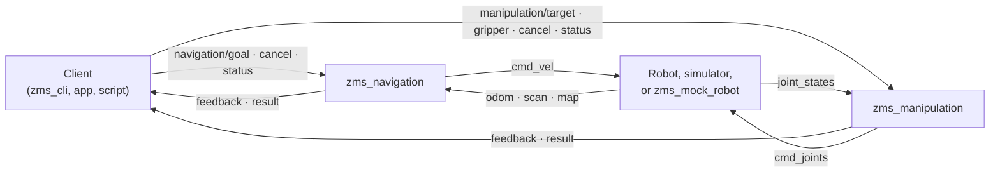

# Zenoh Motion Stacks

Native [Eclipse Zenoh](https://zenoh.io) navigation and manipulation for mobile robots and arms, with no ROS dependency.

[](LICENSE)


Zenoh Motion Stacks ships two standalone processes, `zms_navigation` and `zms_manipulation`. Each
talks only native Zenoh through a small, versioned JSON contract. Any robot, simulator, or client
that speaks the contract can use them; nothing links against this repository at runtime.

## Contents

- [Features](#features)
- [How it works](#how-it-works)
- [Requirements](#requirements)
- [Build](#build)
- [Quick start](#quick-start)
- [Command-line client](#command-line-client)
- [Configuration](#configuration)
- [Contract](#contract)
- [Testing](#testing)
- [Install and package](#install-and-package)
- [Repository layout](#repository-layout)
- [Project status](#project-status)
- [License](#license)

## Features

**Navigation** (`zms_navigation`)

- Waypoint routes for differential-drive bases, with acceleration-limited velocity output
- A\* path planning through an occupancy grid, with re-planning when the route is blocked
- Obstacle avoidance from a 2D laser scan: rolling local A\* detours, a dynamic window controller,
  short-lived obstacle memory, and optional self-hit filtering
- Rotate and back-up recovery when the robot is boxed in
- Particle-filter localization against the map
- Visualization outputs: the planned path, local detour, inflated costmap, and remembered obstacles
- Progress, staleness, and ownership checks that end stuck or orphaned commands

**Manipulation** (`zms_manipulation`)

- Joint targets and end-effector pose targets, checked against URDF joint limits
- Damped least-squares inverse kinematics
- Self and environment collision checking with FCL on URDF primitives
- RRT-Connect planning and synchronized trapezoidal trajectories
- Cartesian straight-line moves
- Gripper open, close, and position commands with grasp detection
- Visualization output: the planned joint trajectory with an end-effector path

**Tooling**

- `zms_cli`: command-line client for every contract request
- `zms_mock_robot`: headless base and joint-arm mock with optional walls, obstacles, scan, and odometry drift
- `zms_conformance`: contract conformance suite that runs against any implementation

## How it works



Requests are Zenoh queries that are accepted or rejected immediately. Progress and terminal results
are published. Each stack declares a liveliness token, so clients can see when it is running.
All keys sit under a configurable robot prefix, which allows several robots on one network.

## Requirements

| Dependency | Version |
| --- | --- |
| Ubuntu | 24.04 |
| CMake | 3.22 or later |
| Compiler | C++20 |
| Ninja | any recent |
| zenoh-c and zenoh-cpp | 1.5.0 or later |
| nlohmann/json | 3.11.3 or later |
| Eigen, urdfdom, FCL 0.7, OMPL | Ubuntu 24.04 packages |
| GoogleTest | for tests |

The installer checks these packages and installs the missing ones. When needed, it adds the
[official Eclipse Zenoh apt source](https://zenoh.io/docs/getting-started/installation/).

```bash
./scripts/install_dependencies.sh --dry-run   # show what would be installed
./scripts/install_dependencies.sh             # install; add --yes to skip prompts
```

If the zenoh-c development package is not available from your apt sources, build it from the
[upstream Zenoh C++ guide](https://github.com/eclipse-zenoh/zenoh-cpp#how-to-build-and-install-it).

## Build

```bash
cmake --preset system
cmake --build --preset system
```

| Preset | Use |
| --- | --- |
| `system` | Uses installed packages only. Output in `build/system`. |
| `release` | Fetches missing nlohmann/json and zenoh-cpp from checksum-pinned archives. zenoh-c must still be installed. Output in `build/release`. |

Install and packaging targets are generated only when every dependency is found on the system.

## Quick start

Run the navigation stack against the mock robot. Open three terminals in the repository root.

```bash
# 1. Mock robot: publishes odometry and stops if commands cease
build/system/zms_mock_robot demo/robot1
```

```bash
# 2. Navigation stack
build/system/zms_navigation --config config/examples/navigation.json
```

```bash
# 3. Send a goal and check status
build/system/zms_cli demo/robot1 operator-1 goal goal-1 1 0 0
build/system/zms_cli demo/robot1 operator-1 status
```

For manipulation, start the mock with arm joints, then the manipulation stack:

```bash
build/system/zms_mock_robot demo/robot1 --joints joint_1,joint_2
build/system/zms_manipulation --config config/examples/manipulation.json
build/system/zms_cli demo/robot1 operator-1 joint-target move-1 joint_1,joint_2 0.3,-0.2
```

Stop each process with <kbd>Ctrl</kbd>+<kbd>C</kbd>.

Both stacks support two utility flags:

```bash
zms_navigation --version                    # supported contract and configuration versions
zms_navigation --check-config <file.json>   # validate a configuration and exit
```

## Command-line client

```text
zms_cli <robot-prefix> <client-id> <command> [arguments]
```

| Command | Arguments | Description |
| --- | --- | --- |
| `goal` | `<id> <x> <y> <yaw>` | Send a navigation goal |
| `cancel` | `<id>` | Cancel a navigation command |
| `status` | | Navigation status |
| `joint-target` | `<id> <names> <positions>` | Move arm joints (comma-separated lists) |
| `pose-target` | `<id> <x> <y> <z> <qx> <qy> <qz> <qw>` | Move the end effector to a pose |
| `cartesian-target` | `<id> <x> <y> <z> <qx> <qy> <qz> <qw>` | Move the end effector along a straight line |
| `gripper` | `<id> open\|close\|<positions>` | Command the gripper |
| `cancel-manipulation` | `<id>` | Cancel a manipulation command |
| `manipulation-status` | | Manipulation status |
| `mock-joints` | `<names> <positions>` | Set mock joint states |
| `watch` | `<navigation\|manipulation> <id> <timeout-s>` | Print feedback until the command ends |
| `watch-viz` | `<navigation\|manipulation> <timeout-s>` | Print visualization outputs until the timeout |

`zms_mock_robot` accepts `--joints`, `--start`, `--wall`, `--obstacle`, `--odom-scale`, and
`--odom-yaw-drift` to build test scenes.

## Configuration

Each stack reads one JSON file. Examples are in [`config/examples`](config/examples):

| File | Purpose |
| --- | --- |
| `navigation.json` | Navigation limits, footprint, avoidance, and localization |
| `manipulation.json` | Two-joint arm example (`two_joint_arm.urdf`) |
| `mobile_manipulator.json` | Mobile manipulator example (`mobile_manipulator.urdf`) |

Field reference: [`docs/configuration.md`](docs/configuration.md),
[`docs/navigation.md`](docs/navigation.md), and [`docs/manipulation.md`](docs/manipulation.md).

## Contract

All payloads are UTF-8 JSON with contract major version `1`. Keys are relative to the robot prefix.

| Key | Operation | Purpose |
| --- | --- | --- |
| `navigation/goal`, `navigation/cancel`, `navigation/status` | query | Submit, cancel, and inspect navigation |
| `navigation/feedback`, `navigation/result` | publish | Progress and terminal state |
| `navigation/path`, `navigation/local_path`, `navigation/costmap`, `navigation/obstacles` | publish | Visualization of the planned path, detour, costmap, and obstacles |
| `manipulation/target`, `manipulation/gripper`, `manipulation/cancel`, `manipulation/status` | query | Submit, cancel, and inspect manipulation |
| `manipulation/feedback`, `manipulation/result` | publish | Progress and terminal state |
| `manipulation/trajectory` | publish | Visualization of the planned joint trajectory |
| `navigation/alive`, `manipulation/alive` | liveliness | Stack presence |
| `cmd_vel`, `cmd_joints` | publish | Commands to the robot |
| `odom`, `scan`, `map`, `joint_states` | subscribe | Robot state and sensors |
| `localization/pose`, `localization/initial_pose` | publish / subscribe | Localization estimate and start pose |

The full specification, including payloads and rejection reasons, is in
[`docs/contract.md`](docs/contract.md).

## Testing

```bash
ctest --preset system
```

| Suite | Coverage |
| --- | --- |
| `zms_unit_tests` | Codecs, configuration validation, URDF, kinematics, collision, planners, avoidance, Cartesian regression |
| `zms_conformance` | Contract behaviour against a fake stack |
| `zms_navigation_integration` | Live Zenoh with the mock robot: navigation workflow, obstacle avoidance, localization with drifting odometry, joint targets, gripper, and tracking failure |

The live Zenoh integration tests are opt-in:

```bash
cmake --preset system -DZMS_ENABLE_LIVE_TESTS=ON
cmake --build --preset system
ctest --preset system
```

To check a separately running navigation stack against the contract:

```bash
ZMS_CONFORMANCE_PREFIX=<robot-prefix> build/system/zms_conformance
```

## Install and package

```bash
cmake --install build/system --prefix <directory>     # install binaries and libraries
cpack --config build/system/CPackConfig.cmake         # create a tarball
```

The exported CMake package is `motion_stacks`:

```cmake
find_package(motion_stacks REQUIRED)
target_link_libraries(my_app PRIVATE motion_stacks::contract_transport)
```

| Target | Contents |
| --- | --- |
| `motion_stacks::contract` | Request and response codecs |
| `motion_stacks::contract_transport` | Zenoh client and server helpers |
| `motion_stacks::navigation_core` | Planning, following, avoidance, localization |
| `motion_stacks::manipulation_core` | Kinematics, collision, planning, trajectories |

The tarball links against installed system libraries; it does not bundle them.

A [`Dockerfile`](Dockerfile) runs the installer, build, and live tests in an Ubuntu 24.04 image:

```bash
docker build -t zenoh-motion-stacks .
```

The container path has not yet been verified.

## Repository layout

```text
contract/        Contract codecs and Zenoh transport helpers
navigation/      zms_navigation and the navigation_core library
manipulation/    zms_manipulation and the manipulation_core library
tools/           zms_cli and zms_mock_robot
tests/           unit, conformance, and integration tests
config/examples/ Example configurations and URDFs
docs/            Contract and stack reference
scripts/         Dependency installer
```

## Project status

Early stage, version 0.2.0. The contract is at major version 1.

Planned:

- Omnidirectional and car-like drive models
- OMPL-based planning
- Mesh collision geometry
- Jerk-limited stopping
- Runtime obstacle updates for manipulation
- Verified clean-container build

## License

Licensed under the [Apache License 2.0](LICENSE).

Eclipse Zenoh is a trademark of the Eclipse Foundation. This independent project is not affiliated
with or endorsed by the Eclipse Foundation.
